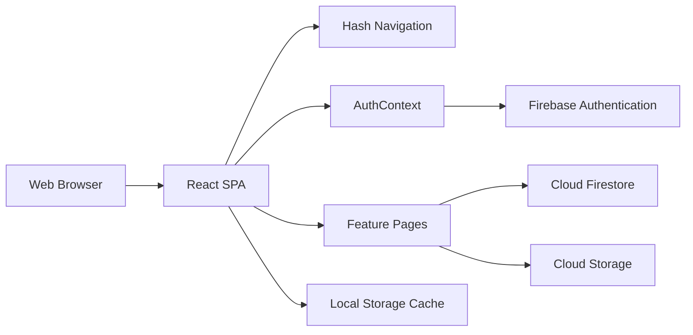

# Rabona Architecture

## 1. System Overview

Rabona is a React + TypeScript single-page football community application. The client runs through Vite and uses Firebase for authentication, database persistence, and media storage.

The current signup experience creates only two user types:

- Player
- Coach

Football academies are modeled as public page-like entities. They are not shown as a signup option, but existing academy records remain supported for browsing, details, and subscriptions.

## 2. Application Layers

### Presentation layer

- `src/App.tsx`: application shell, authentication gate, hash navigation, and page selection.
- `src/components/`: shared navigation, avatar, icon, stars, pitch artwork, and layout helpers.
- `src/pages/`: user-facing screens.
- `src/index.css`: shared design tokens and page-specific styles.

### State and integration layer

- `src/context/AuthContext.tsx`: Firebase auth state, profile loading, registration, profile media updates, and sign out.
- `src/lib/firebase.ts`: Firebase app, Auth, Firestore, Storage, and Google provider initialization.
- `src/lib/firestoreErrors.ts`: Firestore error handling.
- `src/utils/`: image compression and notification helpers.

### Data layer

Cloud Firestore stores structured application data. Firebase Storage stores uploaded media. Local Storage provides fast local caches for the current profile, academy list, and newly published feed items.

`firestore.indexes.json` contains the composite indexes for the audience-aware feed query. Public profile fields are projected into `publicProfiles/{uid}` so private email, address, and birth data are not used for public profile reads.

## 3. Navigation and Authentication

`App.tsx` uses `window.location.hash` as the lightweight router. Supported areas include:

- `login` and `signup`
- `home`
- `academies` and `academy`
- `new-post`
- `bookings`
- `profile`
- `notifications`
- `settings`
- `store`
- `admin`

Unauthenticated users are redirected to `login`, except while completing `signup`. Existing authenticated users with a completed profile are redirected from login to home.

## 4. Registration Model

### Player

`SignupPage` collects identity, date of birth, preferred foot, field position, and location. The result is written to:

- `users/{uid}` with `role: player`
- `players/{uid}` with player-specific details
- `publicProfiles/{uid}` with safe display fields

### Coach

`SignupPage` collects identity, coaching title, experience, specialties, license, location, venues, plans, and supported age range. The result is written to:

- `users/{uid}` with `role: coach`
- `coaches/{uid}` with coach-specific details
- `publicProfiles/{uid}` with safe display fields

### Academy pages

Academies are stored as page-like records in `academies/{academyId}`. An academy record may contain:

- page name and owner
- profile image and cover image
- bio and location
- categories and age range
- plans, price, capacity, and available spots
- ratings and former players

Academy list pages read public academy records and cache them in `rabona_academies`. Academy detail pages present the academy as a public community page with a cover, profile image, bio, actions, tabs, plans, schedule, reviews, and map.

## 5. Main Feature Modules

| Module | Responsibility | Main data |
| --- | --- | --- |
| HomeFeed | Feed, stories, likes, comments, post media | `posts`, `stories` |
| NewPostPage | Compose text, upload up to four images, optional match score, publish | `posts`, Storage |
| AcademiesPage | Search, filtering, location ranking, academy cards | `academies` |
| AcademyDetailPage | Public academy page, plans, reviews, map, subscription entry | `academies`, `bookings` |
| BookingsPage | User academy subscriptions and booking records | `bookings`, `academies` |
| ProfilePage | User profile, role data, media, activity | `publicProfiles`, `users`, `players`, `coaches`, `posts` |
| StorePage | Store products, cart, orders | `orders` |
| AdminDashboard | Administrative management and moderation | multiple collections |

## 6. Media Flow

1. The user selects an image in a page component.
2. The image is compressed or converted to a browser data URL.
3. The client uploads media to Firebase Storage when the feature requires durable media.
4. The resulting download URL is written to Firestore or cached locally.
5. The UI renders the URL in feed, profile, academy, or detail views.

Post images use the path pattern:

`posts/{authorUid}/{postId}/{imageId}.webp`

## 7. Security Boundaries

Firestore rules provide the server-side authorization boundary:

- public reads for public feed, academy, and review data where configured
- owner-only writes for profiles, posts, bookings, and owned academy pages
- admin-only operations for protected management actions
- validation of required fields, roles, IDs, strings, counts, and allowed keys
- admin access through a Firebase `admin` custom claim or an `admins/{uid}` document
- audience-aware post reads and atomic like-counter checks

Client-side validation improves UX but is not the security boundary.

## 8. Current Production Gaps

- Firebase Storage is configured in the client and rules are present, but Storage is not enabled in the `rabona-eg` Firebase project.
- Some existing profile and story flows still use compressed data URLs; migrating them to Storage requires a controlled data migration.
- Admin custom claims or `admins/{uid}` records must be provisioned through trusted Admin SDK or Console operations.
- Store products and online payment are not production-enabled; orders remain a pending/manual-payment concern until a trusted catalog and payment flow exist.

## 9. Runtime and Deployment

- Development server: `npm run dev`
- TypeScript validation: `npm run lint`
- Production build: `npm run build`
- Firebase configuration: `firebase.json`, `firestore.rules`, and `storage.rules`
- Hosting entry point: Vite build output
