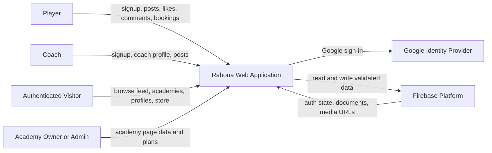
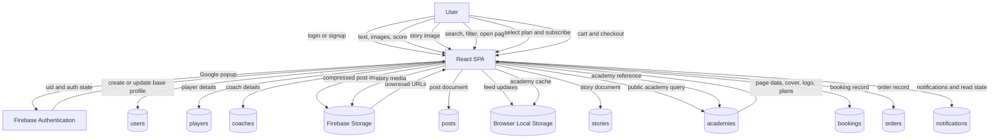
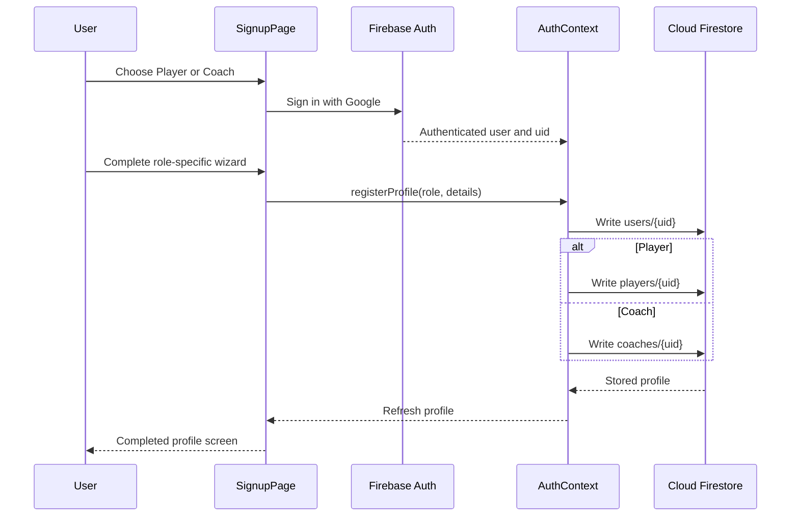
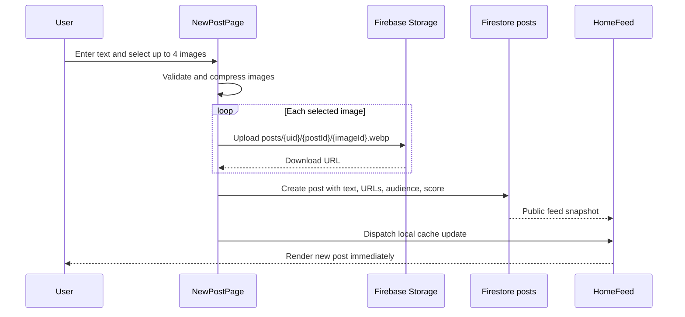
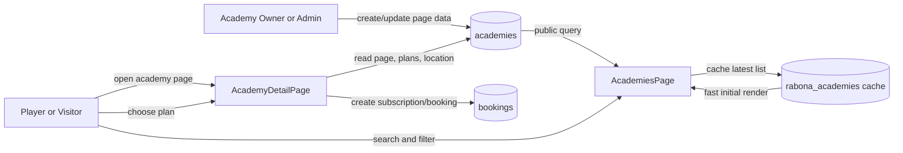

# Rabona Data Flow Diagram

## 1. Context Diagram

## 2. Level 1 Data Flow

## 3. Registration Data Flow

## 4. Post and Upload Data Flow

## 5. Academy Page and Subscription Flow

## 6. Core Data Stores

| Store | Contents | Access pattern |
| --- | --- | --- |
| `users` | shared identity, role, profile media, bio | authenticated read; owner/admin write |
| `players` | football identity and location | authenticated read; owner write |
| `coaches` | coaching profile, specialties, plans | authenticated read; owner write |
| `academies` | public academy pages, plans, capacity, ratings | public read; owner/admin write |
| `posts` | feed posts, media URLs, reactions counters | public read; authenticated owner/action writes |
| `stories` | temporary user stories and expiry | public read; owner write |
| `bookings` | player subscriptions and academy bookings | owner/admin access |
| `orders` | store checkout records | user/admin access |
| `notifications` | user alerts and read state | recipient/admin access |
| Firebase Storage | uploaded post, story, profile, cover media | URL-based media retrieval with storage rules |
| Browser Local Storage | cached profile, academies, instant feed entries | local browser only |

## 7. Important Rules

- The browser is a client, not the authorization layer.
- Firestore and Storage rules must validate ownership and allowed fields.
- Signup exposes only `player` and `coach` choices.
- Academy records remain first-class public pages and can be read independently of signup.
- Uploaded media should be compressed before upload where the feature supports it.
